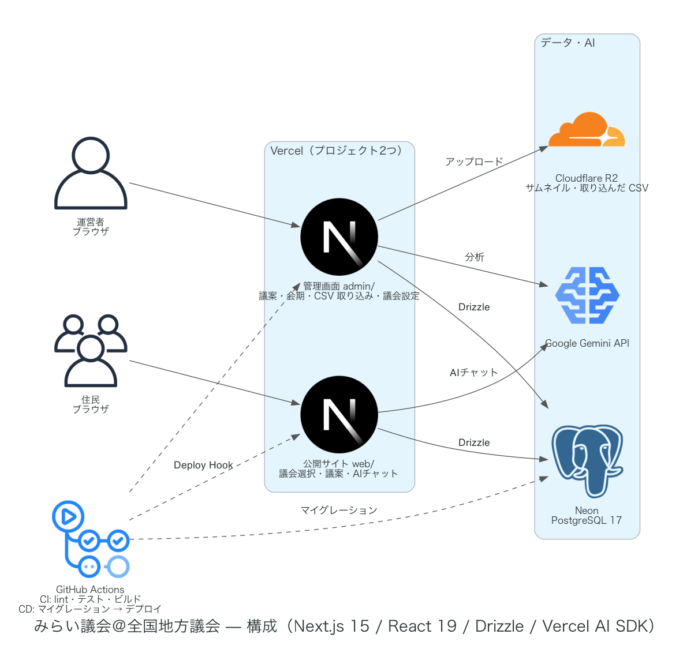

# 開発ガイド

チームみらいの「みらい議会」(https://gikai.team-mir.ai/ , [team-mirai/mirai-gikai](https://github.com/team-mirai/mirai-gikai))
を元に、全国の地方議会向けに作り直している非公式な個人制作サイトです。
設計は [docs/地方議会プラットフォーム設計_v3.md](docs/地方議会プラットフォーム設計_v3.md)、本番への出し方は [docs/デプロイ手順.md](docs/デプロイ手順.md) を見てください。
コードの書き方の決まりは [AGENTS.md](AGENTS.md) にまとめています（AI のコーディング支援もこれを読みます）。



## クイックスタート

必要なもの: Node.js 20 以上、pnpm、Docker

```bash
pnpm install
cp .env.example .env                 # GOOGLE_GENERATIVE_AI_API_KEY を入れると AI チャットも動く
pnpm db:up                           # PostgreSQL を起動（Docker、ポート 54322）
pnpm db:migrate                      # テーブルと DB function を作る
pnpm seed                            # 愛知県議会の実データと、46都道府県のダミー議会を入れる
pnpm admin:create you@example.com    # 管理者を作る（初期パスワードが表示される）
pnpm dev                             # 公開サイト http://localhost:3000 ・管理画面 http://localhost:3001
```

Gemini の API キーは https://aistudio.google.com/apikey で発行できます。無くても、AI チャット・インタビュー以外は動きます。

- DB を初期状態に戻す: `pnpm db:reset`（コンテナを消して作り直し、マイグレーションとシードを流し直す）
- DB の中身を見る: `docker compose exec db psql -U postgres -d mirai_gikai`

## プロジェクト構造

pnpm のモノレポです。公開サイトと管理画面は別の Next.js アプリで、DB や共通の処理は `packages/` に置いています。

```
mirai-gikai-zenkoku/
├── web/                            # 公開サイト（Next.js 15、App Router）
│   └── src/
│       ├── app/                    # ルート定義だけ（/、/[assembly]/...、/cities・/towns、/api/...）
│       ├── features/               # 画面とロジック（assemblies・bills・sessions・chat・interview-* など）
│       ├── components/             # ヘッダー・フッター・UI 部品
│       └── lib/                    # routes.ts（内部リンク）・匿名 ID の Cookie・AI のモデル など
├── admin/                          # 管理画面（Next.js 15、ポート 3001）
│   └── src/
│       ├── app/(protected)/        # ログイン後の画面（/、/[assembly]/bills・sessions・import・settings、/bills/[id]/...）
│       ├── features/               # assemblies・bills・bills-edit・bill-results・csv-import・sessions・auth・admins など
│       └── lib/                    # routes.ts・ファイルの保存（Vercel Blob）など
├── packages/
│   ├── db/                         # Drizzle のスキーマ（src/schema/tables.ts）とマイグレーション（migrations/）
│   ├── shared/                     # web と admin で共通の処理（CSV 取り込み・ふりがな・議決結果の保存・都道府県と日本地図・AI のモデル など）
│   ├── topic-analysis-core/        # インタビューの意見のトピック分析
│   └── seed/                       # データ投入（愛知県の実データ・ダミー議会・本番の初期データ・管理者の作成）
├── tests/db/                       # DB を使う統合テスト（DB function・リポジトリ）
├── docs/                           # 設計・デプロイ手順・構成図
└── scripts/                        # 構成図の生成など
```

web・admin の中は、Bulletproof React の feature ごとの構成です。`app/` の `page.tsx` は引数を feature に渡すだけにし、
DB を読む処理は `server/`、ブラウザで動く部品は `client/`、外部に依存しない計算は `shared/utils/`（純粋関数とテスト）に置きます。

## データについて

| データ | 置き場所 | 件数 | 作り方 |
|---|---|---|---|
| 47都道府県議会の議会マスタ | `packages/seed/lib/prefecture-assemblies.ts` | 47 | シードで入れる。管理画面の「議会マスタを CSV で取り込む」でも足せる |
| 愛知県議会の会期・議案・議決結果 | `packages/seed/aichi/data/*.csv` | 会期5・議案226 | 愛知・名古屋版（mirai-gikai-nagoya）から `pnpm --filter @mirai-gikai/seed aichi:convert -- <パス>` で書き出したもの |
| 愛知県議会の解説 | `packages/seed/aichi/data/explained.json` | 5件 | 同上。`seed:aichi-contents` で入れ直せる |
| ダミーの議会 | `packages/seed/dummy/` | 46議会・議案138 | `pnpm seed:dummy`。実データのある議会には入れない |

- **ダミーと実データは1つの議会に混ぜません。** 実データを入れる操作（議案の登録・会期の追加・CSV の取り込み）は、ダミーが残っていれば確認したうえで消してから入れます。
- ダミーは件名に「【ダミー】」が付き、公開サイトでは帯・バッジ・`noindex`・サイトマップからの除外で示します（設計 v3 8.5節）。
- 議会のデータは、各議会の公式サイトから手で集めて CSV にし、管理画面から取り込みます。自動で取りに行く仕組み（スクレイピング）は今は持っていません。

## 管理画面

管理者は全員同じ権限で、すべての議会・機能を扱えます。ログインはメールアドレスとパスワードです（パスワードは PostgreSQL の `pgcrypto` でハッシュにして保存）。

| 画面 | URL | できること |
|---|---|---|
| 議会一覧 | `/` | 日本地図と議会の一覧。議会を選んで開く |
| 議案一覧 | `/[assembly]/bills` | 絞り込み・並べ替え・まとめて公開／下書きに戻す |
| 議案の登録・編集 | `/[assembly]/bills/new`・`/bills/[id]/edit` | 議案の項目、解説（ふつう・くわしく）、議決結果と会派ごとの賛否、サムネイル |
| 会期 | `/[assembly]/sessions` | 会期の追加・編集 |
| CSV 取り込み | `/[assembly]/import` | 議案・議決結果・会期・会派をまとめて登録・更新（確認画面でエラーの行を確かめてから取り込む） |
| 議会設定 | `/[assembly]/settings` | AI チャット・インタビュー・議決結果の粒度などの切り替え、ダミーデータの削除 |
| 議会マスタの取り込み | `/assemblies/import` | 議会そのものを CSV で追加・更新 |
| アカウント | `/admins` | 管理者の追加・初期パスワードの再発行・削除 |

- 保存すると、公開サイトのキャッシュを消してすぐ反映します（`REVALIDATE_SECRET`）。
- CSV のひな形は、取り込み画面からダウンロードできます（議決結果のひな形は、いま有効な会派名が列になります）。Shift_JIS の CSV も読めます。

## ふりがな

`kuromoji` の形態素解析で、保存するときにサーバーで作って DB に入れます（`packages/shared/src/furigana/`）。
件名・解説の本文の両方に付き、公開サイトの「ふりがな」の切り替えで表示します。

## AI

AI は Google Gemini を Vercel AI SDK で直接呼びます。モデルは `packages/shared/src/ai/models.ts` で用途ごとに決め、
呼び出すときは必ず `geminiModel()` を通します（モデル名の文字列をそのまま渡すと、Vercel AI Gateway につなぎに行ってしまいます）。

- **AI チャット**（公開サイト）: 議案の情報をそのままシステムプロンプトに入れて答えます（ベクトル検索は使いません）。1人1日・全体の費用の上限があります（`CHAT_*_COST_LIMIT_USD`）。
- **AI インタビュー・トピック分析**: 議会設定で有効にした議会だけで出します（ダミーデータが残っている議会では出せません）。住民が公開を許可した回答だけを掲載し、完了するたびに、その場で（応答のあと、同じ関数の中で）議案のトピックをまとめ直します。回答は期限を決めずに保存します。

## 変更するとき

1. スキーマを変えたら `packages/db/src/schema/tables.ts` を直し、`pnpm db:generate` → 生成された SQL を確かめる → `pnpm db:migrate`。
2. ページを足したら、各アプリの `src/lib/routes.ts` にも足します（`routes.test.ts` が確かめます）。
3. 変更のあと、次がすべて通ることを確かめます（CI と同じ）。

```bash
pnpm lint
pnpm typecheck
pnpm test
pnpm test:integration   # pnpm db:up と pnpm db:migrate のあとで
pnpm build
```

コミット時には `lint-staged` で Biome の整形が自動でかかります。

## 構成図を作り直す

構成図（`docs/architecture.png`）は `scripts/architecture-diagram.py` から作ります。

```bash
pip install diagrams      # Graphviz も要る（brew install graphviz）
python3 scripts/architecture-diagram.py
```

## ライセンス

[AGPL-3.0](LICENSE)。fork して運営する場合は [FORK_GUIDELINES.md](FORK_GUIDELINES.md) に従ってください。
